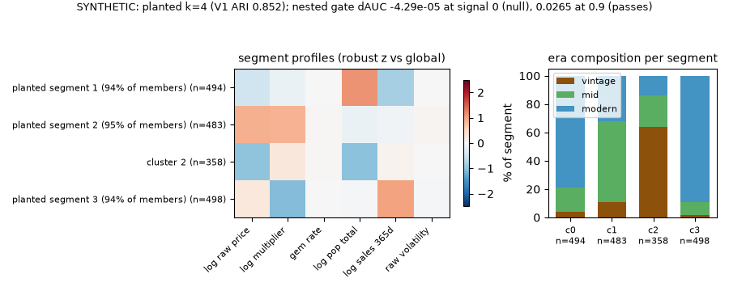

# cardsegments

Segmenting the graded-card market: block-pruned features, k selected
honestly, stability-tested clusters, and a leak-audited supervised
validation — with pre-registered predictions.

[](https://github.com/chasebak/cardsegments/actions/workflows/ci.yml)


<!-- ladder-headline:begin (generated by python -m cardsegments.ladder_report build; do not edit) -->
**SYNTHETIC (illustrative preset): at the cost-set threshold t* = 2/3 the full logistic's buy list parks less capital than the trailing-sales logistic's — 11.8% vs 31.1% of flagged cards sat unsold (Δ +19.31 pp, 95% CI [+12.82, +25.80]; ΔAUC +0.0966 [+0.0787, +0.1149]) when segments carry planted signal; with no planted segment effect the gap vanishes (Δ -0.33 pp, CI [-0.68, +0.03]; ΔAUC -0.0001 [-0.0004, +0.0002]).**
<!-- ladder-headline:end -->



Collectors send trading cards to a grading service; each card then trades
at a raw (ungraded) price and a graded price. The grade premium
(multiplier), the share of submissions earning the top grade (gem rate),
graded population counts and sales velocity jointly describe where a card
sits in that market — those are the axes being segmented here.

## Quickstart

```bash
git clone https://github.com/chasebak/cardsegments && cd cardsegments
python3 -m venv .venv && source .venv/bin/activate
pip install -e . -r requirements-ci.txt
python -m cardsegments.demo   # synthetic end-to-end, < 90 s, writes ./out/ only
python -m pytest -q           # acceptance gates on planted synthetic structure
python -m cardsegments.ladder_report --check   # README/DECISIONS blocks match results/
python -m cardsegments.synth_findings --check   # findings.md + README blocks match the bundle
python -m cardsegments.viz build --check   # Buy List Explorer page data + blocks are fresh
```

Supported platforms: macOS arm64 and Linux (CI runs Ubuntu, Python
3.11/3.12/3.13).

The demo generates planted-segment data in the public adapter schema and
runs the whole pipeline on it: screen → select k → stability bootstrap →
null controls → profiles/era lifts → supervised validation → a rendered
findings report under `out/`. A cloner's ten-minute path is that demo plus
the committed (synthetic) null-control figure in `reports/figures/`.

## What is in the box

| module | job |
|---|---|
| `screen.py` | Spearman/Pearson matrices, feature blocks (average linkage on 1−\|rho\|, cut 0.2), one-representative pruning, VIF, ranked R²-on-price table, price residualization |
| `cluster.py` | k-means + silhouette + gap statistic (PCA-box reference, one-SE, k=1 allowed); GMM BIC + ICL over three covariance families; fixed tiebreak by bootstrap ARI |
| `stability.py` | bootstrap resample → full refit → Hungarian-matched ARI (mean / min / 5th pct), k*±1 |
| `nullcontrol.py` | the identical selection pipeline on matched-Gaussian and column-shuffled nulls |
| `supervised.py` | grouped stratified CV with in-fold clustering and an explicit `no_cluster` category, nested ΔAUC gate, cost-threshold confusion analysis, calibration |
| `ladder.py`, `ladder_predictions.py`, `ladder_report.py` | two grouped k-fold model ladders on identical folds (classification and count regression), shuffled-label and oracle checks, the parked-capital buy-list KPI, pre-registered predictions judged by code, and the generated README/DECISIONS/METHOD blocks |
| `viz.py`, `report.py` | figures and `findings.md`, regenerated entirely from the aggregates bundle; disclosure suppression (n < 50) enforced in code; refuses to render a bundle not labelled synthetic into `reports/` |
| `buylist.py`, `explorer.py` | the 49-point buy-list threshold grid (both lists, three cost settings, exact-t* cells, regret, paired parked-rate CIs), checked against the frozen ladder, and the Buy List Explorer page data in `docs/` (`python -m cardsegments.viz build`) |
| `synth_findings.py` | the synthetic-only v2 of the findings: the whole method on planted-truth data, pre-registered predictions judged by code, and the generated findings README/DECISIONS/METHOD blocks |
| `synth.py`, `adapters/byo_csv.py` | seeded planted-segment generator and the one data seam (see `docs/ADAPTER_SCHEMA.md`) |

Every committed result is **synthetic**. [`reports/findings.md`](reports/findings.md)
and its figures are regenerated by `python -m cardsegments.report` from
[`reports/results_bundle.json`](reports/results_bundle.json), which
`python -m cardsegments.synth_findings build` computes on planted-truth data
(the bundle carries `provenance.label = "synthetic"`, and `report.py` refuses to
render any other bundle into `reports/`). The licensed-data run is private
until the price-feed terms are read.

<!-- ladder-section:begin (generated by python -m cardsegments.ladder_report build; do not edit) -->
## Model ladders and the buy list (SYNTHETIC, illustrative preset)

Two grouped k-fold model ladders on identical folds (5 folds × 10 seeds), run on the illustrative synthetic preset: n = 12,000 cards in 150 set groups, planted base rate 0.23 (realized 0.229 at signal 0, 0.233 at signal 0.9), liquid = at least 5 sales. Round illustrative values, not the private cohort. Predictions were registered first ([`results/PREDICTIONS_synthetic_ladder_2026-11-04.md`](results/PREDICTIONS_synthetic_ladder_2026-11-04.md)); full tables, answers and the shuffled-label control are in [`results/LADDER.md`](results/LADDER.md).

| KPI | formula | why it matters | compared against | what the software does to it | measured on | value now |
|---|---|---|---|---|---|---|
| **Parked-capital rate at t\*** (headline) | FP/(TP+FP) among cards with pooled out-of-fold P(liquid) ≥ t* = (m+h)/(2m+h) = 2/3; Δ = parked(velocity) − parked(model), paired group bootstrap | A flagged card that sits ties up cash for the outcome window | velocity logistic, same folds, same t* ('buy everything' is context only) | screens buys at a threshold set from costs | synthetic truth | signal 0.9: model 11.8% vs velocity 31.1%, Δ +19.31 pp [+12.82, +25.80] (`results/ladder_frozen.json:738`); signal 0: model 12.6% vs velocity 12.3%, Δ -0.33 pp [-0.68, +0.03] (`results/ladder_frozen.json:224`) |
| Lift over velocity | ΔAUC (pooled OOF), paired group bootstrap; 'beats' = CI excludes 0 AND Δ ≥ +0.01 | what the extra features buy beyond trailing sales | velocity logistic | measures the lift and its CI | synthetic truth | signal 0.9: +0.0966 [+0.0787, +0.1149], beats: yes; signal 0: -0.0001 [-0.0004, +0.0002], beats: no (0.9 `results/ladder_frozen.json:731`; 0 `results/ladder_frozen.json:217`) |
| Decision cost and threshold regret | cost(t) = ((m+h)·FP + m·FN)/N at m = h = 0.10; regret = cost(t*) − min(grid minimum, cost(t*)), as a share of cost(t*) | near-0 regret means a threshold set from the cost ratio works without peeking at outcomes | 'buy none'; the hindsight-best of 49 grid thresholds | lowers cost per card | synthetic truth (illustrative cost units) | signal 0.9: model cost(t*) 0.01159, regret 3.31%; velocity cost(t*) 0.02272, regret 3.08%; 'buy none' 0.02331; signal 0: model cost(t*) 0.01349, regret 0.19%; velocity cost(t*) 0.01334, regret 0.00%; 'buy none' 0.02292 (0.9 `results/buylist_grid.json:1565`; 0 `results/buylist_grid.json:57`) |
| Calibration | Brier = mean (p − y)² (fold mean); skill = 1 − Brier/(p̄(1 − p̄)) and ECE over quantile bins with n ≥ 50 (pooled out-of-fold) | a fixed t* works only if 0.70 means 7 in 10 sell | velocity logistic; the base-rate predictor (skill 0) | shows whether the probabilities can be trusted | synthetic truth | signal 0.9: model Brier 0.0607 (fold mean), skill 0.661, ECE 0.005; velocity Brier 0.1230 (fold mean), skill 0.312, ECE 0.038; signal 0: model Brier 0.0785 (fold mean), skill 0.555, ECE 0.008; velocity Brier 0.0784 (fold mean), skill 0.556, ECE 0.008 (Brier 0.9 `results/ladder_frozen.json:554`; 0 `results/ladder_frozen.json:40`; skill, ECE 0.9 `results/buylist_grid.json:2032`; 0 `results/buylist_grid.json:524`) |
| Count-regression gain | ΔR² on log1p(sold count), best rung vs velocity OLS; Poisson deviance vs the oracle | answers 'which type of regression' | velocity OLS; the planted Poisson rate | ranks the regression families | synthetic truth | signal 0.9: gbr ΔR² +0.3332 [+0.3017, +0.3666]; signal 0: poisson_glm ΔR² +0.0379 [+0.0335, +0.0429]; gate 0.014 (0.9 `results/ladder_frozen.json:846`; 0 `results/ladder_frozen.json:332`) |
| Gate power (MDE) | smallest planted signal at which the gate ships in ≥ 80% of seeds | a null counts only if the test could find something | the signal-0 null | turns 'found nothing' into 'could detect ≥ X' | synthetic truth | to measure |

> **Why this metric.** Of the cards the buy list flags at t*, what share sits unsold and ties up cash, and does the model's list beat the free trailing-sales list?
> *Kind of number:* Counted: FP / flagged on pooled out-of-fold predictions of SYNTHETIC cards; truth is the generator's drawn sold count (>= 5 sales = liquid).
> *What would make it lie:* It would lie if folds leaked or t* were tuned on test data; t* comes from costs only, and the shuffled-label band, group-disjoint folds and oracle-bound tests guard the folds (tests/test_ladder.py).

> **Why this metric.** When the model says 0.70, do about 7 in 10 of those cards sell, so that a threshold set from costs means what it says?
> *Kind of number:* Modelled: Brier = mean (p - y)^2, skill = 1 - Brier / (p_bar (1 - p_bar)) and ECE over quantile bins with n >= 50, on pooled out-of-fold probabilities of SYNTHETIC cards; truth is the drawn sold count.
> *What would make it lie:* Errors of opposite sign inside one bin cancel in ECE, and skill mixes ranking with calibration; tests check that the base-rate predictor scores skill 0 exactly, a hand-made 3-bin ECE, and that a +1.5 logit shift raises ECE (tests/test_buylist.py).

**Guarantees (tests, not KPIs)**

- Every rung of both ladders scored on identical outer folds: yes; set groups shared between train and test: 0; rungs with an internal split: 0.
- Shuffled-label control inside the pre-registered band at both signals: yes.
- Rungs beating the planted-truth oracle by more than 0.01: 0.
- Predictions file pinned before the frozen run (sha256 prefix `8080fa48c5a6a42e`); a test fails if it changes.
- The illustrative preset's defaults leave the committed synth/ example datasets unchanged (tests/test_synth.py).

### Classification ladder, signal 0.9 (planted segment effect)

| model | AUC mean ± sd (50 folds) | pooled AUC [95% CI] | ΔAUC vs velocity [95% CI] | beats? | Brier mean ± sd | fit seconds |
|---|---|---|---|---|---|---|
| majority (train-fold base rate) | 0.5000 ± 0.0000 | excluded (constant) | — | — | 0.1788 ± 0.0007 | 0.0 |
| velocity logistic (trailing sales, L2 C=1) | 0.8702 ± 0.0192 | 0.8696 [0.8501, 0.8890] | — | — | 0.1230 ± 0.0073 | 0.2 |
| full logistic, unpenalized (C=inf) | 0.9663 ± 0.0031 | 0.9662 [0.9610, 0.9703] | +0.0966 [+0.0787, +0.1149] | yes | 0.0607 ± 0.0027 | 0.2 |
| full logistic, L2 C=1 (was primary_logistic) | 0.9663 ± 0.0031 | 0.9662 [0.9610, 0.9704] | +0.0966 [+0.0787, +0.1149] | yes | 0.0607 ± 0.0027 | 0.2 |
| gradient boosting (gbc, defaults) | 0.9746 ± 0.0030 | 0.9748 [0.9710, 0.9779] | +0.1052 [+0.0867, +0.1239] | yes | 0.0523 ± 0.0032 | 64.3 |
| ORACLE (planted P(liquid)) | 0.9791 ± 0.0026 | 0.9790 | — | — | 0.0479 ± 0.0031 | — |

**Answer (signal 0.9).** Highest fold-mean AUC: gbc (0.9746). logistic_unpenalized, logistic_l2_c1, gbc beat the velocity logistic under the rule (CI excludes 0 AND ΔAUC ≥ +0.01): the extra features proxy the planted segments that trailing sales cannot see. gbc leads logistic_l2_c1 by +0.0084 fold-mean AUC, under the +0.01 bar, so the simpler model is kept. The best rung sits 0.0044 AUC below the oracle (0.9791).

**Answer (signal 0).** Highest fold-mean AUC: velocity (0.9404). No rung beats the velocity logistic under the rule (CI excludes 0 AND ΔAUC ≥ +0.01); in this generator at signal 0 the planted P(liquid) depends on trailing sales alone, so velocity already ranks cards in the oracle's order. The best rung sits 0.0000 AUC below the oracle (0.9404).

> **Why this metric.** Does a more complex model rank cards by 'will it sell' better than a logistic on trailing sales?
> *Kind of number:* Modelled: out-of-fold ROC-AUC and Brier on SYNTHETIC cards, 5 folds x 10 seeds on identical grouped folds; truth is the planted P(liquid).
> *What would make it lie:* Leakage would inflate every rung; the shuffled-label band and the 'no rung beats the oracle' check would then fail (tests/test_ladder.py).

### Count-regression ladder on log1p(sold count), signal 0.9

| model | MSE mean ± sd | MAE mean ± sd | R² mean ± sd | pooled R² | ΔR² vs velocity OLS [95% CI] | passes gate? | Poisson deviance | fit seconds |
|---|---|---|---|---|---|---|---|---|
| mean (train-fold mean) | 0.8653 ± 0.0213 | 0.7698 ± 0.0101 | -0.0003 ± 0.0004 | -0.0001 | — | — | 6.5678 ± 0.3472 | 0.0 |
| velocity OLS (trailing sales) | 0.4792 ± 0.0246 | 0.5795 ± 0.0174 | 0.4454 ± 0.0358 | 0.4462 | — | — | n/a (log1p target) | 0.0 |
| OLS, full features | 0.2652 ± 0.0060 | 0.4142 ± 0.0052 | 0.6932 ± 0.0100 | 0.6935 | +0.2473 [+0.2173, +0.2791] | yes | n/a (log1p target) | 0.1 |
| Huber (robust, epsilon 1.35) | 0.2661 ± 0.0062 | 0.4129 ± 0.0052 | 0.6922 ± 0.0104 | 0.6924 | +0.2463 [+0.2165, +0.2779] | yes | n/a (log1p target) | 0.5 |
| Poisson GLM on the raw count (unpenalized) | 0.2233 ± 0.0072 | 0.3855 ± 0.0054 | 0.7416 ± 0.0124 | 0.7419 | +0.2958 [+0.2678, +0.3261] | yes | 1.3642 ± 0.0269 | 1.0 |
| gradient boosting regressor (gbr, defaults) | 0.1918 ± 0.0060 | 0.3562 ± 0.0053 | 0.7781 ± 0.0101 | 0.7793 | +0.3332 [+0.3017, +0.3666] | yes | n/a (log1p target) | 62.2 |
| ORACLE (planted Poisson rate) | 0.1780 ± 0.0048 | 0.3447 ± 0.0045 | 0.7940 ± 0.0085 | 0.7942 | — | — | 1.0276 ± 0.0227 | — |

**Answer (signal 0.9).** Highest fold-mean R²: gbr (0.7781). PASSES the R² gate (ΔR² CI excludes 0 AND ΔR² ≥ 0.014): ols, huber, poisson_glm, gbr. On the same features the Poisson GLM beats OLS by +0.0484 fold-mean R²: the count is Poisson with a log link, which a straight line on log1p misses. Oracle R² 0.7940.

**Answer (signal 0).** Highest fold-mean R²: poisson_glm (0.6780). PASSES the R² gate (ΔR² CI excludes 0 AND ΔR² ≥ 0.014): poisson_glm, gbr. On the same features the Poisson GLM beats OLS by +0.0375 fold-mean R²: the count is Poisson with a log link, which a straight line on log1p misses. Oracle R² 0.6781.

> **Why this metric.** Which kind of regression best predicts how many times a card sells?
> *Kind of number:* Modelled: out-of-fold MSE / MAE / R^2 on log1p(sold count) plus Poisson deviance, SYNTHETIC cards; truth is the planted Poisson rate.
> *What would make it lie:* R^2 on log1p hides count-scale errors and a constant has R^2 <= 0 by construction; the oracle row bounds every rung, and the GLM-oracle deviance gap is checked at signal 0 only, where the planted log-rate is linear in trailing sales; at signal 0.9 the GLM, linear in the features, cannot represent the planted segment offsets, so its gap is printed, not bounded (results/LADDER.md; tests/test_ladder.py).

Pre-registered predictions: 10 confirmed of 10 (verdicts by code, listed in `results/LADDER.md`).
<!-- ladder-section:end -->

<!-- explorer-section:begin (generated by python -m cardsegments.viz build; do not edit) -->
## Buy List Explorer (SYNTHETIC page)

**Try it (60 s):** the Buy List Explorer page in `docs/` (`python -m http.server -d docs`, then open the address it prints) lets you drag the buy threshold across 49 precomputed points from 0.02 to 0.98 and watch the full logistic's and the velocity logistic's buy lists fill side by side, at planted signal 0 and 0.9 and three cost settings; every number on it comes from `python -m cardsegments.viz build`.

Each buy list is every card whose pooled out-of-fold P(liquid) is at or above the threshold, on the illustrative preset (n = 12,000 cards per signal). At each preset cost setting's exact t* (read from [`results/buylist_grid.json`](results/buylist_grid.json), written by `python -m cardsegments.buylist build`):

| planted signal | cost setting | full logistic: parked / missed sellers | velocity: parked / missed sellers | Δ parked (velocity − model) [95% CI] | threshold regret, model / velocity (share of cost at t*) |
|---|---|---|---|---|---|
| signal 0 | m 0.10 · h 0.10 → t* = 2/3 | 12.6% / 1,161 missed (42.2%) | 12.3% / 1,155 missed (42.0%) | -0.33 pp [-0.68, +0.03] | 0.19% / 0.00% |
| signal 0 | m 0.10 · h 0.05 → t* = 3/5 | 15.5% / 1,023 missed (37.2%) | 15.3% / 1,019 missed (37.1%) | -0.20 pp [-0.61, +0.20] | 0.00% / 0.20% |
| signal 0 | m 0.10 · h 0.20 → t* = 3/4 | 8.5% / 1,377 missed (50.1%) | 8.6% / 1,376 missed (50.0%) | +0.06 pp [-0.40, +0.51] | 0.45% / 0.17% |
| signal 0.9 | m 0.10 · h 0.10 → t* = 2/3 | 11.8% / 875 missed (31.3%) | 31.1% / 2,052 missed (73.4%) | +19.31 pp [+12.82, +25.80] | 3.31% / 3.08% |
| signal 0.9 | m 0.10 · h 0.05 → t* = 3/5 | 13.6% / 742 missed (26.5%) | 32.7% / 1,840 missed (65.8%) | +19.16 pp [+12.53, +25.97] | 0.41% / 0.00% |
| signal 0.9 | m 0.10 · h 0.20 → t* = 3/4 | 8.2% / 1,037 missed (37.1%) | 25.5% / 2,318 missed (82.9%) | +17.32 pp [+11.30, +23.40] | 0.00% / 3.95% |

> **Why this metric.** How many cards that went on to sell does each buy list pass over?
> *Kind of number:* Counted: FN and FN / (TP + FN) at the threshold, pooled out-of-fold predictions of SYNTHETIC cards; truth is the drawn sold count.
> *What would make it lie:* A list can look safe by flagging almost nothing; parked rate and missed sellers are always shown together, and FN must never fall as the threshold rises (tests/test_buylist.py).

> **Why this metric.** Does the threshold set from my costs alone come close to the best threshold I could have picked after seeing the outcomes?
> *Kind of number:* Modelled cost: ((m+h) FP + m FN) / N in illustrative units at the exact t* cell vs the cheapest of the 49 grid thresholds, SYNTHETIC cards; regret = cost(t*) - min(grid best, cost(t*)).
> *What would make it lie:* Miscalibrated probabilities would push the best threshold away from t*; regret >= 0 is tested, a shifted-logit vector must raise it, and t* comes from m and h only, never from test labels (tests/test_buylist.py).
<!-- explorer-section:end -->

<!-- findings-headline:begin (generated by python -m cardsegments.synth_findings build; do not edit) -->
## Headline findings (SYNTHETIC v2, from the committed bundle)

Every number below is read from [`reports/results_bundle.json`](reports/results_bundle.json), computed on generated data with planted truth; the full report is [`reports/findings.md`](reports/findings.md). None of it is a claim about the real market.

- **The gap statistic misses the planted k; the stability tiebreak still lands on it (a loss on prediction 1, shipped as printed).** On V1 (n=1833, 6 features, planted k=4 at separation 2) the gap statistic (one-SE) picks k=1 and the chosen solution (gmm diag k=4) matches the planted labels with ARI 0.852; its bootstrap mean ARI is 0.992 (B=200). The price-residualized V4 picks gmm diag k=4 (bootstrap mean ARI 0.99).
- **It does not invent segments.** The gap statistic picks k=1 on the matched-Gaussian null and k=1 on the column-shuffled null; BIC picks full k=1 and diag k=2 there, which is why mixture criteria stay descriptive. At separation 1 the gap statistic picks k=1.
- **The honest null, on synthetic data.** With no planted segment effect (cluster_signal 0, n=12000, base rate 0.229) the nested gate (era + velocity + cluster over era + velocity) gives FAILS (null): mean dAUC -4.29e-05, CI [-0.000164, 0.000105], ships=False. With the planted effect (cluster_signal 0.9) it gives PASSES: mean dAUC 0.0265, CI [0.0224, 0.0308], ships=True.
- Pre-registered predictions ([`results/PREDICTIONS_synthetic_findings_2026-11-04.md`](results/PREDICTIONS_synthetic_findings_2026-11-04.md), sha256 prefix `e0cca286390d9fcd`): 8 confirmed, 2 refuted, 0 not decidable (verdicts by code, listed in the findings report).

> **Why this metric.** Does knowing a card's segment help predict whether it sells, beyond era and trailing sales?
> *Kind of number:* Modelled: pooled out-of-fold ΔAUC of era + velocity + cluster over era + velocity on SYNTHETIC cards, paired group bootstrap; truth is the planted segment effect (0 or 0.9).
> *What would make it lie:* Leakage or a gate that always passes would show a lift at signal 0; the signal-0 case must FAIL and the signal-0.9 case must PASS (predictions 8 and 9), and the clusters are re-fit inside every training fold.
<!-- findings-headline:end -->

## Evaluation protocol

- **Grouped, stratified CV**: StratifiedGroupKFold on hashed set ids
  (5 folds × 10 seeds); imputation and scaling refit inside every
  training fold.
- **In-fold cluster value-add**: clusters are re-fit inside each training
  fold on rows with complete cluster features (k frozen at the full-data
  k* — a mild selection leak, disclosed below); test rows without
  complete features get an explicit `no_cluster` category, so the nested
  comparison runs on the full cohort.
- **Nested gate**: ΔAUC of (era + velocity + cluster) over
  (era + velocity), paired group-level bootstrap (B=1000) on pooled
  out-of-fold predictions. The predictive claim ships only if the 95% CI
  excludes 0 AND mean ΔAUC ≥ +0.01; otherwise the result is reported as a
  null. No t-tests on CV folds.
- **Cost-aware threshold**: t\* = C_FP/(C_FP+C_FN) with C_FP = m+h and
  C_FN = m (illustrative defaults m = h = 0.10 → t\* = 2/3); the defaults
  are illustrative, and the threshold-cost curve is drawn for three
  (m, h) settings so no conclusion hinges on them.
- **PR-AUC oriented to the minority class** — stated per run, because the
  realized base rate decides which class that is.
- **Null controls and stability are the structure arbiters**; silhouette
  and BIC/ICL are descriptive (see the null-control finding below).
- **Acceptance gates on synthetic truth** (in `tests/`): mean
  planted-truth ARI ≥ 0.9 at separation 3, ≥ 0.6 at moderate separation,
  planted k recovered in ≥ 80% of seeds, and the null controls must find
  no structure.

## Design decisions / what didn't work

- **Era one-hots as clustering features: rejected.** Euclidean distance
  on dummies is an arbitrary weighting choice; k-prototypes/Gower was not
  worth the dependency. Era is held out and used as validation instead —
  recovered composition is evidence, not input.
- **Whitening before k-means: rejected.** It destroys centroid
  interpretability and is partially redundant with full-covariance GMM.
- **`era_label` / `release_year` never enter X** (circularity: era
  recovery is one of the registered predictions).
- **A price-residualized companion (V4)**: price level can dominate a raw
  market matrix's leading axis, so V4 keeps price as one axis and
  residualizes the others on it; both views are run and reported.
- **Mixture criteria chase non-Gaussian marginals.** On a column-shuffled
  null (no structure by construction) BIC/ICL can still pick k>1, so the
  gap statistic and bootstrap stability arbitrate structure; the synthetic
  null-control table in `reports/findings.md` shows what each criterion
  picks on the nulls.
- **Synthetic-only findings**: the licensed-feed report was
  replaced by a synthetic v2 run of the same method, so no tracked file
  carries a licensed-feed aggregate; see `DECISIONS.md`, 2026-11-04 —
  Findings regenerated on synthetic data only.
- **Student-t latent noise in the synthetic generator: rejected.** The
  mixture criteria kept inventing an extra component for the tails even
  at high separation; the generator now uses Gaussian log-scale noise and
  gets heavy tails from the lognormal feature maps.
- **In-fold clustering freezes k at the full-data k***: disclosed as a
  mild selection leak (re-selecting k inside every fold was rejected as
  unstable at these fold sizes).
- **No t-tests on CV folds**; the Nadeau–Bengio correction was the
  considered alternative, and a group-level bootstrap was chosen instead.

## What this does NOT claim

- No causal claims — segments summarize covariance in one snapshot.
- **Every committed number is synthetic.** The findings report, its
  figures and the bundle show what the method does when the truth is
  planted; they say nothing about the real market.
- Strategy readings of segments are hypotheses, not validated policies.
- Not investment advice.
- Cluster quality is **reported, not optimized**: whatever the gap
  statistic and the stability bootstrap say ships as printed, including
  the weak-separation sensitivity.
- A synthetic generator with Gaussian log-scale clusters is easier than a
  real market; recovering it is a necessary check, not evidence the real
  market has segments.
- The model-ladder and buy-list numbers are **synthetic**: they show the
  method recovers planted truth and that its leakage checks can fail; they
  say nothing about the real market. The real-data ladder run waits on the
  price-feed terms.
- The parked-capital comparison is **descriptive** (no gate); the +0.01 AUC
  and R² gates are the pre-registered rules.
- No rung is tuned; L1 / elastic-net / tuned boosting rungs are not tested
  here.
- The Buy List Explorer page is a **precomputed view of the synthetic
  run**: it computes nothing, shows no real card, and no live URL is
  claimed (GitHub Pages is switched on by hand). Its threshold regret is
  in illustrative cost units, not dollars.
- The page does **not** apply the n ≥ 50 disclosure floor: its data are
  synthetic, so a few high-threshold cells rest on lists of a handful of
  cards (counted in `DECISIONS.md`, 2026-11-05 — No n < 50 suppression on
  the synthetic page). A real-data page must re-apply `apply_disclosure`.
- The leakage band is **wide**: it was registered from a single-fold sd,
  so it catches only leaks above its measured detection limit (in
  `results/LADDER.md`); the GLM-oracle deviance bound is checked at
  signal 0 only.

## Data

Everything committed here is synthetic. The method was built for a
segmentation study on licensed per-card market data that stays private;
its results are not published until the feed terms are read. See
[`DATA.md`](DATA.md): `reports/results_bundle.json` is a synthetic
aggregates bundle (every cell carries its n, n < 50 suppressed in code),
and the BYO-CSV adapter runs the same pipeline on your own data.

## References

- Rousseeuw (1987), *Silhouettes*, J. Comput. Appl. Math. 20.
- Tibshirani, Walther & Hastie (2001), *Estimating the number of clusters
  via the gap statistic*, JRSS-B 63(2).

Further background and the full reference list: `docs/METHOD.md`.

---

Part of a set of public repos extracted from my card-business tooling —
see my GitHub profile for the map.
