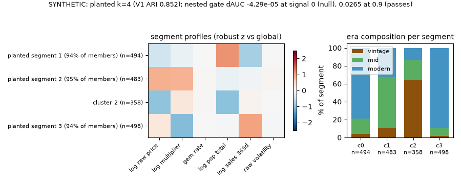
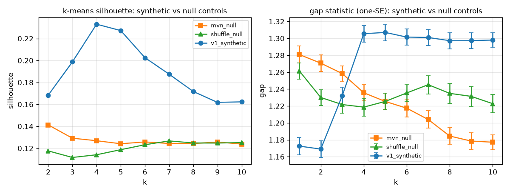
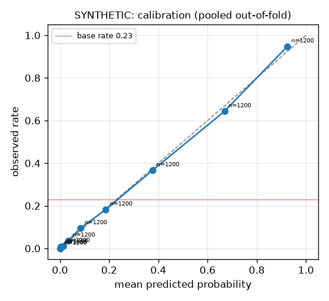
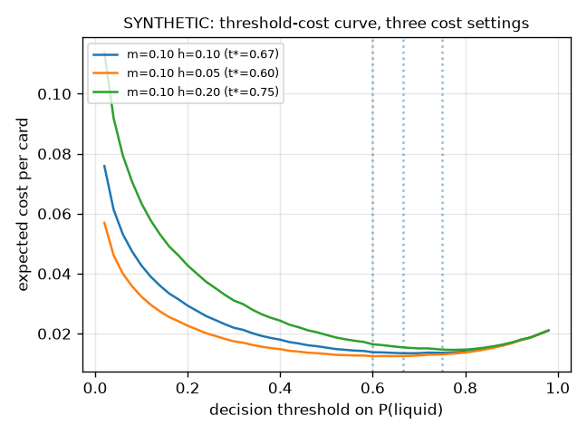

# Findings (SYNTHETIC v2) - graded-card market segmentation method

*This file and every figure under figures/ are regenerated by `python -m cardsegments.report` from `reports/results_bundle.json`, which `python -m cardsegments.synth_findings build` computes. Suppression rule: any per-group cell with n < 50 is suppressed in code.*

**SYNTHETIC DATA ONLY.** Every number in this report comes from data generated by `cardsegments.synth` (planted segments, planted outcomes), so it shows what the method does when the truth is known. It says nothing about the real market. The private licensed-data run is not published until the price-feed terms are read (see DECISIONS.md, 2026-11-04 — Findings regenerated on synthetic data only).

## Structure verdict (V1, primary feature set)

**segments are a useful quantization of a continuum, not well-separated clusters.** The gap statistic (one-SE) chooses k=1 on the primary matrix (n=1833); the best k-means silhouette on synthetic V1 is 0.233, vs the column-shuffled null's 0.127. The GMM criteria prefer cov=diag k=4 (bootstrap mean ARI 0.992) - read as a descriptive quantization of a continuum, not as well-separated clusters.

Planted truth: k=4 segments; adjusted Rand index of the chosen V1 solution against the planted labels = 0.852 (n=1833).

The price-residualized companion V4 (price kept as one axis, the other axes residualized on it): gmm diag k=4 with bootstrap mean ARI 0.99 (min 0.976 over 200 resamples).

> **Why this metric.** Does the selection pipeline find the segments that are really there, and only those?
> *Kind of number:* Simulated: gap statistic, silhouette, BIC/ICL and bootstrap ARI on SYNTHETIC cards with planted segments; truth is the planted labels (adjusted Rand index against them).
> *What would make it lie:* An easy generator flatters any method; the matched-Gaussian and column-shuffled nulls and the weak-separation sensitivity must read as no structure (tests/test_cluster_gates.py, prediction 4 and 5).

Sensitivity variants (selection only):

| variant | n | p | silhouette k | gap one-SE k | GMM pick | chosen solution | max silhouette |
|---|---|---|---|---|---|---|---|
| v2_weak_separation | 1833 | 6 | 6 | 1 | spherical k=6 | gmm spherical k=6 | 0.138 |
| v3_selection_effect | 1617 | 6 | 4 | 4 | diag k=4 | kmeans k=4 | 0.229 |
| v1_core | 2000 | 4 | 4 | 1 | diag k=4 | gmm diag k=4 | 0.365 |

**Narrative rule (fixed before writing):** "every characterizing sentence cites a profile number whose CI excludes the global value; only segments surviving ALL robustness cells get names; fragile structure goes to a k-sensitivity appendix"

## Segments (V4, price-residualized companion)

Profile medians below are on the ORIGINAL feature scale (per-feature median, card-level bootstrap 95% CI, cell n). Only clusters surviving all robustness cells carry names.

- cluster 0: **planted segment 1 (94% of members)**
- cluster 1: **planted segment 2 (95% of members)**
- cluster 2: (unnamed - failed a robustness cell)
- cluster 3: **planted segment 3 (94% of members)**

| cluster | n | log raw price | log multiplier | gem rate | log pop total | log sales 365d | raw volatility |
|---|---|---|---|---|---|---|---|
| 0 | 494 | 2.46 [2.38, 2.66] (n=494) | 1.22 [1.17, 1.29] (n=494) | 0.501 [0.488, 0.513] (n=494) | 9.47 [9.32, 9.65] (n=494) | 3.23 [3.07, 3.38] (n=494) | 0.203 [0.197, 0.212] (n=494) |
| 1 | 483 | 5.55 [5.47, 5.64] (n=483) | 2.51 [2.45, 2.6] (n=483) | 0.504 [0.491, 0.514] (n=483) | 6.78 [6.58, 6.87] (n=483) | 4.54 [4.42, 4.65] (n=483) | 0.208 [0.201, 0.216] (n=483) |
| 2 | 358 | 1.32 [1.22, 1.51] (n=358) | 1.79 [1.69, 1.88] (n=358) | 0.504 [0.488, 0.517] (n=358) | 4.99 [4.78, 5.17] (n=358) | 4.88 [4.67, 5.01] (n=358) | 0.204 [0.198, 0.211] (n=358) |
| 3 | 498 | 4.15 [4.04, 4.36] (n=498) | 0.0628 [0.0186, 0.125] (n=498) | 0.5 [0.487, 0.514] (n=498) | 7.07 [6.88, 7.2] (n=498) | 6.49 [6.42, 6.67] (n=498) | 0.203 [0.197, 0.21] (n=498) |
| global | 1833 | 3.55 (IQR 3) | 1.42 (IQR 1.69) | 0.502 (IQR 0.15) | 7.13 (IQR 2.82) | 4.71 (IQR 2.38) | 0.204 (IQR 0.0859) |

## Era composition

Era labels were NEVER features; composition below is recovery, not input. Cramer's V (cluster x era) = 0.555 on V4, 0.555 on V1. Lift = P(era | cluster) / P(era); a CI excluding 1 marks the cluster era-enriched.

V4 era lifts (CI over 200 Hungarian-matched stability resamples):

| cluster | n | era | lift | 95% CI | era-enriched |
|---|---|---|---|---|---|
| 0 | 494 | vintage | 0.262 | [0.209, 0.31] |  |
| 0 | 494 | mid | 0.643 | [0.58, 0.704] |  |
| 0 | 494 | modern | 1.39 | [1.35, 1.42] | YES |
| 1 | 483 | vintage | 0.657 | [0.573, 0.732] |  |
| 1 | 483 | mid | 2.15 | [2.07, 2.24] | YES |
| 1 | 483 | modern | 0.564 | [0.535, 0.598] |  |
| 2 | 358 | vintage | 3.74 | [3.59, 3.9] | YES |
| 2 | 358 | mid | 0.845 | [0.758, 0.917] |  |
| 2 | 358 | modern | 0.247 | [0.213, 0.273] |  |
| 3 | 498 | vintage | 0.0944 | [0.0592, 0.12] |  |
| 3 | 498 | mid | 0.349 | [0.301, 0.395] |  |
| 3 | 498 | modern | 1.58 | [1.55, 1.61] | YES |

SYNTHETIC: era labels were planted as a different era mixture per segment (synth.ERA_MIXES) and never entered the features. On V4, cluster 2 is the strongest vintage-enriched cluster (lift 3.74, CI [3.59, 3.9]); cluster 1 is the strongest mid-enriched cluster (lift 2.15, CI [2.07, 2.24]); cluster 3 is the strongest modern-enriched cluster (lift 1.58, CI [1.55, 1.61]). Recovering a planted mixture checks the lift and CI code; it is not a claim about how real eras sort into segments.

## Trends per segment

Not computed on synthetic data: the generator draws no price history, so there is no trailing price change to summarize. The protocol (median 90 d / 365 d log change per segment, >= 5 sales in each endpoint window) runs only on the private data.

## Robustness and stability

Bootstrap ARI (B=200, 80% resamples, Hungarian-matched) of each variant's chosen solution: V4 gmm diag k=4 mean 0.99 / min 0.976; V1 gmm diag k=4 mean 0.992 / min 0.976. Robustness cells (k*-1, k*, k*+1 per variant; survival = recall >= 0.7 in every cell):

V1 cells:
- k=3: recall c0=0.96 (n=499), c1=0.91 (n=497), c2=1 (n=487), c3=0 (n=350)
- k=4: recall c0=1 (n=499), c1=1 (n=497), c2=1 (n=487), c3=1 (n=350)
- k=5: recall c0=0.98 (n=499), c1=0.99 (n=497), c2=1 (n=487), c3=0.95 (n=350)

V4 cells:
- k=3: recall c0=0.88 (n=494), c1=1 (n=483), c2=0 (n=358), c3=0.97 (n=498)
- k=4: recall c0=1 (n=494), c1=1 (n=483), c2=1 (n=358), c3=1 (n=498)
- k=5: recall c0=0.98 (n=494), c1=0.96 (n=483), c2=0.99 (n=358), c3=0.98 (n=498)

Fragile structure (any cluster failing a cell) is excluded from naming above; the k-sensitivity detail stays in this appendix rather than the narrative.

## Null-data control

| dataset | silhouette k | gap one-SE k | BIC pick | ICL pick | max silhouette |
|---|---|---|---|---|---|
| mvn_null | 2 | 1 | full k=1 | full k=1 | 0.141 |
| shuffle_null | 7 | 1 | diag k=2 | spherical k=1 | 0.127 |
| v1_synthetic | 4 | 1 | diag k=4 | diag k=4 | 0.233 |

**Read honestly:** mixture criteria respond to non-Gaussian marginals, not only to cluster structure; the gap statistic and bootstrap stability are therefore the structure arbiters, and silhouette/BIC are descriptive.

> **Why this metric.** Would the pipeline invent segments in data that has none?
> *Kind of number:* Simulated control: the identical pipeline on a matched-Gaussian sample and on column-shuffled data; truth is 'no structure' by construction.
> *What would make it lie:* Mixture criteria react to non-Gaussian marginals, so BIC/ICL can pick k > 1 on a null; the gap statistic and bootstrap stability are the arbiters, and the gates in tests/test_cluster_gates.py fail if the gap statistic finds structure in a null.

## Supervised validation (SYNTHETIC illustrative preset, leak-audited)

### SYNTHETIC illustrative preset, cluster_signal 0 (no planted segment effect)

Cohort n=12000 (150 groups), base rate 0.229. Cluster features complete for 8400 rows; all remaining rows carry the explicit `no_cluster` category, so the nested comparison runs on the full cohort.

Outcome (SYNTHETIC): y_liquid = 1 when the generator's drawn sold count is at least 5; the count is Poisson with a planted segment effect of 0 (no calendar window).

| model | pooled OOF ROC-AUC | 95% group-bootstrap CI |
|---|---|---|
| majority (train-fold base rate) | 0.491 | [0.453, 0.529] |
| era-only logistic | 0.567 | [0.542, 0.59] |
| velocity logistic (trailing sales) | 0.94 | [0.934, 0.946] |
| era + velocity logistic | 0.94 | [0.934, 0.946] |
| era + velocity + cluster logistic | 0.94 | [0.934, 0.946] |
| full logistic, L2 C=1 (key primary_logistic) | 0.94 | [0.934, 0.946] |
| gradient boosting (gbc, defaults) | 0.938 | [0.932, 0.944] |

**Nested gate** (era+velocity+cluster over era+velocity): mean dAUC over seeds = -4.29e-05; paired group-bootstrap 95% CI [-0.000164, 0.000105]; fold-level spread mean -4.27e-05, min -0.000471, 5th pct -0.000378 (50 fold-seed cells).

**Verdict:** The ship rule (95% CI excludes 0 AND mean delta AUC >= +0.01) FAILS: this is a NULL result - in-fold cluster membership does not add predictive signal beyond era and trailing velocity, and the segmentation's value here is descriptive, not predictive.

**Decisions at the cost threshold** t* = 0.667 (C_FP = m+h, C_FN = m, illustrative defaults m = h = 0.10 → t* = 2/3). In buyer's terms: a false positive is capital parked in a card that sits; a false negative is passing on a card that would have sold. The threshold is high because parking capital costs more than missing one flip. The defaults are illustrative; the threshold-cost curve is drawn for three (m, h) settings so no conclusion hinges on them.

| | predicted liquid | predicted sits |
|---|---|---|
| actually liquid | TP=1589 | FN=1161 |
| actually sits | FP=229 | TN=9021 |

precision 0.874, recall 0.578, specificity 0.975, F1 0.696 (n=12000). PR-AUC oriented to the minority class (liquid (y=1)): 0.848.

**Forward-price regression (secondary):** out-of-fold R^2 = -0.00261 on n=2381 eligible cards. The generator draws this target as pure noise on a random ~20% of rows, so out-of-fold R^2 <= 0 is the expected null control, not a claim.

Full logistic (L2, C=1; key `primary_logistic`) coefficients (standardized scale; group-bootstrap 95% CI):

| feature | coef | 95% CI |
|---|---|---|
| log raw price | -0.0528 | [-0.121, 0.00454] |
| log multiplier | 0.00215 | [-0.0787, 0.0827] |
| gem rate | 0.0314 | [-0.0236, 0.088] |
| log pop total | -0.0128 | [-0.0848, 0.0545] |
| log sales 365d | 3.59 | [3.43, 3.72] |
| raw volatility | -0.00207 | [-0.0714, 0.0728] |

### SYNTHETIC illustrative preset, cluster_signal 0.9 (planted segment effect)

Cohort n=12000 (150 groups), base rate 0.233. Cluster features complete for 8342 rows; all remaining rows carry the explicit `no_cluster` category, so the nested comparison runs on the full cohort.

Outcome (SYNTHETIC): y_liquid = 1 when the generator's drawn sold count is at least 5; the count is Poisson with a planted segment effect of 0.9 (no calendar window).

| model | pooled OOF ROC-AUC | 95% group-bootstrap CI |
|---|---|---|
| majority (train-fold base rate) | 0.49 | [0.413, 0.567] |
| era-only logistic | 0.719 | [0.696, 0.739] |
| velocity logistic (trailing sales) | 0.87 | [0.85, 0.889] |
| era + velocity logistic | 0.932 | [0.924, 0.939] |
| era + velocity + cluster logistic | 0.959 | [0.953, 0.964] |
| full logistic, L2 C=1 (key primary_logistic) | 0.966 | [0.961, 0.97] |
| gradient boosting (gbc, defaults) | 0.975 | [0.971, 0.978] |

**Nested gate** (era+velocity+cluster over era+velocity): mean dAUC over seeds = 0.0265; paired group-bootstrap 95% CI [0.0224, 0.0308]; fold-level spread mean 0.0264, min 0.0183, 5th pct 0.0213 (50 fold-seed cells).

**Verdict:** The ship rule (95% CI excludes 0 AND mean delta AUC >= +0.01) PASSES: cluster membership adds predictive signal beyond era and trailing velocity.

**Decisions at the cost threshold** t* = 0.667 (C_FP = m+h, C_FN = m, illustrative defaults m = h = 0.10 → t* = 2/3). In buyer's terms: a false positive is capital parked in a card that sits; a false negative is passing on a card that would have sold. The threshold is high because parking capital costs more than missing one flip. The defaults are illustrative; the threshold-cost curve is drawn for three (m, h) settings so no conclusion hinges on them.

| | predicted liquid | predicted sits |
|---|---|---|
| actually liquid | TP=1922 | FN=875 |
| actually sits | FP=258 | TN=8945 |

precision 0.882, recall 0.687, specificity 0.972, F1 0.772 (n=12000). PR-AUC oriented to the minority class (liquid (y=1)): 0.905.

**Forward-price regression (secondary):** out-of-fold R^2 = -0.0066 on n=2324 eligible cards. The generator draws this target as pure noise on a random ~20% of rows, so out-of-fold R^2 <= 0 is the expected null control, not a claim.

Full logistic (L2, C=1; key `primary_logistic`) coefficients (standardized scale; group-bootstrap 95% CI):

| feature | coef | 95% CI |
|---|---|---|
| log raw price | 0.0724 | [5.83e-05, 0.133] |
| log multiplier | -1.04 | [-1.19, -0.892] |
| gem rate | 0.0117 | [-0.0646, 0.0919] |
| log pop total | 1.97 | [1.86, 2.06] |
| log sales 365d | 3.16 | [2.99, 3.32] |
| raw volatility | 0.0199 | [-0.0621, 0.089] |

> **Why this metric.** Does knowing a card's segment help predict whether it sells, beyond era and trailing sales?
> *Kind of number:* Modelled: pooled out-of-fold ΔAUC of era + velocity + cluster over era + velocity on SYNTHETIC cards, paired group bootstrap; truth is the planted segment effect (0 or 0.9).
> *What would make it lie:* Leakage or a gate that always passes would show a lift at signal 0; the signal-0 case must FAIL and the signal-0.9 case must PASS (predictions 8 and 9), and the clusters are re-fit inside every training fold.

**Supervised-design notes:**

- Realized base rates 0.229 (signal 0) and 0.233 (signal 0.9) against the planted 0.23; the positive liquid class is the minority, so PR-AUC is oriented to it.
- The generator removes the gem-rate cluster feature from about 30% of rows (3600 of 12000 at signal 0); they carry the explicit no_cluster category, so the nested comparison runs on the full cohort.
- b_log1p_sold_365d equals f_log1p_sales_365 by construction in the generator, so the velocity baseline and that feature column are the same information.
- fwd_log_price_change is planted as pure noise on about 20% of rows (2381 eligible at signal 0); its R^2 is a null control, not a finding.

## Registered predictions, judged

Predictions were registered on 2026-11-04 (sha256 e0cca286390d9fcd...) before any pilot inspection. Verdicts below are decided by the named statistic, not by narrative.

| # | prediction (summary) | verdict | deciding statistic |
|---|---|---|---|
| 1 | V1 gap statistic recovers the planted k | **refuted** | gap one-SE k=1, planted k=4 |
| 2 | V1 solution recovers the planted labels (ARI >= 0.90) | **refuted** | planted-truth ARI 0.852 |
| 3 | V1 solution is stable (bootstrap mean ARI >= 0.90) | **confirmed** | bootstrap mean ARI 0.992 (B=200) |
| 4 | both null controls find no structure (gap k=1) | **confirmed** | gap one-SE k: matched-Gaussian 1, column-shuffled 1 |
| 5 | weak separation reads as a continuum (gap k=1) | **confirmed** | gap one-SE k=1 at separation 1 |
| 6 | era composition recovered without era features (V4) | **confirmed** | vintage: cluster 2 lift 3.74 CI [3.59, 3.9]; modern: cluster 0 lift 1.39 CI [1.35, 1.42] |
| 7 | gem rate is a nuisance axis (abs Spearman rho with multiplier < 0.10) | **confirmed** | Spearman rho -0.00306 (n=1833) |
| 8 | honest null: the nested gate FAILS at signal 0 | **confirmed** | mean dAUC -4.29e-05, CI [-0.000164, 0.000105], ships=False |
| 9 | the nested gate PASSES at signal 0.9 | **confirmed** | mean dAUC 0.0265, CI [0.0224, 0.0308], ships=True |
| 10 | planted-noise forward price: out-of-fold R^2 <= 0 | **confirmed** | R^2 -0.00261 (signal 0), -0.0066 (signal 0.9) |

## Limitations

- Synthetic data only: the generator's distributions are design choices (synth.py docstring); nothing here measures the real market.
- The planted structure is Gaussian on the log scale with a known k; real markets need not be, which is why the null controls and the weak-separation sensitivity are shown.
- No price history is generated, so per-segment trends are not computed.
- The in-fold clustering freezes k at the preset's planted k (3) - a mild selection leak, disclosed in Design decisions.
- The private licensed-data run and its numbers are not in this repo (see DECISIONS.md, 2026-11-04 — Findings regenerated on synthetic data only).
